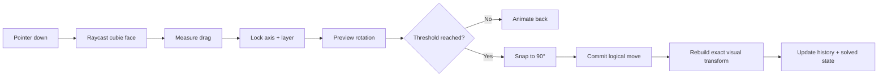

<div align="center">

# Rubik’s Cube

### Premium interactive 3D Rubik’s Cube for the browser

A physically inspired, gesture-first Rubik’s Cube built with **React**, **TypeScript**, **Three.js** and **React Three Fiber**.

[](https://react.dev/)
[](https://threejs.org/)
[](https://www.typescriptlang.org/)
[](https://vite.dev/)

**Interactive · Realistic · Minimalistic · Local-first**

[Quick start](#quick-start) · [Controls](#controls) · [Architecture](#architecture) · [Project structure](#project-structure)

</div>

---

## Preview

<p align="center">
  
</p>

<table>
  <tr>
    <td width="50%"></td>
    <td width="50%"></td>
  </tr>
  <tr>
    <td align="center"><sub>Gesture-driven layer rotation</sub></td>
    <td align="center"><sub>Responsive layout and touch controls</sub></td>
  </tr>
</table>

> The screenshots above are captured from the application itself. No pre-rendered cube model is used in the runtime.

---

## What this project is

This is not a static WebGL showcase and not a wrapper around a ready-made Rubik’s Cube library. The cube mechanics, state model, layer selection and gesture mapping are implemented inside the project.

| | Capability | Implementation |
|---|---|---|
| ◇ | **Premium 3D rendering** | PBR plastic, rounded cubies, reflections, studio lighting and soft contact shadows |
| ↻ | **Physical interaction** | Drag directly on a cubie surface to rotate the corresponding layer |
| ⊞ | **All three slice depths** | Outer faces and middle slices can be manipulated through the same interaction model |
| ◎ | **Stable camera** | Damped orbit controls, bounded zoom and responsive perspective |
| ⌁ | **Discrete cube state** | Integer grid positions and normalized orientation prevent long-term transform drift |
| ↶ | **Undo / Reset / Scramble** | Move-based history and deterministic state transitions |
| ✓ | **Solved detection** | Checked after committed moves with subtle visual feedback |
| ◫ | **Responsive** | Mouse, trackpad, pointer events and touch interaction |

---

## Quick start

### Requirements

- **Node.js 20+**
- npm
- A modern browser with WebGL support

### 1. Clone

```bash
git clone https://github.com/YOUR_USERNAME/YOUR_REPOSITORY.git
cd YOUR_REPOSITORY
```

### 2. Install dependencies

```bash
npm install
```

### 3. Start development server

```bash
npm run dev
```

Open the local URL printed by Vite, normally:

```text
http://localhost:5173/
```

<details>
<summary><strong>Windows PowerShell: scripts are disabled</strong></summary>

If PowerShell blocks `npm.ps1`, there is no need to weaken the execution policy. Use the `.cmd` executable directly:

```powershell
npm.cmd install
npm.cmd run dev
```

</details>

### Production build

```bash
npm run build
npm run preview
```

---

## Controls

| Input | Action |
|---|---|
| <kbd>Left mouse</kbd> + drag **on the cube** | Rotate selected layer |
| <kbd>Left mouse</kbd> + drag **outside the cube** | Orbit camera |
| Mouse wheel / trackpad zoom | Zoom within safe camera bounds |
| Touch drag on cube | Rotate layer |
| Touch drag outside cube | Orbit camera |
| **Scramble** | Generate and animate a valid scramble sequence |
| **Undo** | Reverse the latest user move |
| **Reset** | Restore exact solved state and clear move history |

The gesture axis is locked once the initial drag direction is established. A curved or aggressive pointer movement therefore cannot jump unexpectedly to another layer mid-gesture.

---

## Rendering

The visual target is closer to a product configurator than to a browser puzzle game.

```text
Studio environment
      │
      ├── broad soft key light
      ├── shaped reflection cards
      ├── controlled fill light
      └── contact shadow
              │
              ▼
       Rounded PBR cubies
              │
      ┌───────┴────────┐
      │                │
black plastic      glossy stickers
```

The current graphics pass uses:

- physically based `MeshPhysicalMaterial`;
- rounded cubie geometry rather than sharp boxes;
- dark internal geometry for mechanical depth;
- glossy colored inserts with controlled clearcoat;
- procedural studio environment lighting;
- moving reflection highlights;
- ACES filmic tone mapping;
- soft contact shadows;
- bounded DPR for a balance between edge quality and GPU cost.

The material remains **plastic**, not metallic. Reflections are intentionally strong enough to define bevels without turning the cube into chrome.

---

## Cube mechanics

The render tree is not the source of truth.

Each cubie has a logical state containing:

```ts
position: [-1 | 0 | 1, -1 | 0 | 1, -1 | 0 | 1]
orientation: discrete 3x3 rotation matrix
stickers: fixed local face colors
```

A move is represented by:

```ts
{
  axis: 'x' | 'y' | 'z',
  layer: -1 | 0 | 1,
  quarterTurns: -2 | -1 | 1 | 2
}
```

This gives the project one critical invariant:

> **Animation may use floating-point transforms. Persistent cube state does not.**

After a move completes, the final state is recomputed on the integer grid. Positions therefore return exactly to `-1`, `0` or `1`, and cubie orientation is normalized back to a discrete rotation.

That design prevents the common failure mode where a visually correct cube slowly deforms after dozens or hundreds of rotations.

---

## Move pipeline



During a drag the selected axis and layer are fixed. Only the rotation amount changes until pointer release.

---

## Architecture

The codebase intentionally separates **cube mathematics**, **interaction**, and **rendering**.

```text
Input / Pointer Events
        │
        ▼
Gesture interpretation
        │
        ▼
Logical CubeMove
        │
        ├──────────────► History / Undo
        │
        ▼
Discrete CubeState
        │
        ▼
Visual transform derivation
        │
        ▼
React Three Fiber scene
```

This separation is what makes `Reset`, `Undo`, scrambling and solved detection reliable instead of depending on arbitrary mesh transforms.

---

## Project structure

```text
rubiks-premium/
├── src/
│   ├── components/
│   │   ├── Controls.tsx
│   │   ├── Cubie.tsx
│   │   ├── RubiksCube.tsx
│   │   └── Scene.tsx
│   │
│   ├── cube/
│   │   ├── CubeState.ts
│   │   ├── moves.ts
│   │   ├── scramble.ts
│   │   ├── solved.ts
│   │   └── types.ts
│   │
│   ├── graphics/
│   │   └── materials.ts
│   │
│   ├── interaction/
│   │   └── gesture.ts
│   │
│   ├── math/
│   │   └── discrete.ts
│   │
│   ├── App.tsx
│   ├── main.tsx
│   └── styles.css
│
├── index.html
├── package.json
├── tsconfig.json
└── vite.config.ts
```

### Responsibility split

| Layer | Responsibility |
|---|---|
| `cube/` | State transitions, move representation, scramble generation, solved-state logic |
| `interaction/` | Surface drag interpretation, axis/layer detection, gesture locking |
| `math/` | Discrete coordinate and rotation operations |
| `components/` | Scene graph, animation, pointer integration and UI |
| `graphics/` | Shared visual constants and material configuration |

---

## Tech stack

| Technology | Role |
|---|---|
| **React 19** | Application state and component composition |
| **TypeScript** | Strictly typed interaction and cube model |
| **Three.js** | WebGL rendering, materials, transforms and raycasting |
| **React Three Fiber** | React renderer for the Three.js scene graph |
| **@react-three/drei** | Camera controls, rounded geometry, environment helpers and contact shadows |
| **Vite 8** | Development server and production build |

No backend is required.

---

## Performance strategy

Visual quality is intentionally constrained by interaction stability.

- DPR is limited instead of rendering blindly at the device’s maximum pixel ratio.
- Shadow resolution is bounded.
- The scene contains only the geometry required for a 3×3×3 cube.
- Logical state updates happen only when a move commits.
- Pointer preview uses transient transforms instead of mutating permanent state every frame.
- Camera motion uses damping rather than expensive physics simulation.

The target is stable interactive rendering on a normal modern laptop rather than maximum synthetic visual complexity.

---

## Development

```bash
# development
npm run dev

# type-check + production build
npm run build

# preview production build
npm run preview
```

The production interface intentionally stays minimal. Development diagnostics can be enabled through the `DEBUG` constant in `src/App.tsx`.

---

## Screenshots for this README

For the cleanest GitHub presentation, keep three real application screenshots in:

```text
docs/readme/
├── hero.png
├── interaction.png
└── mobile.png
```

Recommended captures:

| File | Capture |
|---|---|
| `hero.png` | Desktop, solved cube, initial product-shot camera, UI visible |
| `interaction.png` | Desktop, cube partially rotated or scrambled to show depth/reflections |
| `mobile.png` | Mobile viewport, portrait orientation |

Recommended desktop size: **1600×900** or **1920×1080**. Crop browser chrome; keep only the application viewport.

---

## Version

Current stable visual baseline: **v1.2**.

The v1.2 pass keeps the deliberately minimal interface while refining overall exposure, color separation and studio presentation.

---

<div align="center">

**Classic puzzle. Modern interaction. Exact mechanics.**

<sub>Built with React · TypeScript · Three.js · React Three Fiber</sub>

</div>
