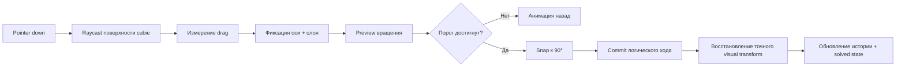

<p align="center">
  <a href="README.md">English</a> · <strong>Русский</strong>
</p>

<div align="center">

# Rubik’s Cube

### Премиальный интерактивный 3D-кубик Рубика в браузере

Физически правдоподобный Rubik’s Cube с управлением жестами, реализованный на **React**, **TypeScript**, **Three.js** и **React Three Fiber**.

[](https://react.dev/)
[](https://threejs.org/)
[](https://www.typescriptlang.org/)
[](https://vite.dev/)

**Интерактивный · Реалистичный · Минималистичный · Локальный**

[Быстрый старт](#быстрый-старт) · [Управление](#управление) · [Архитектура](#архитектура) · [Структура проекта](#структура-проекта)

</div>

---

## Предпросмотр

<p align="center">
  
</p>

<table>
  <tr>
    <td width="50%"></td>
    <td width="50%"></td>
  </tr>
  <tr>
    <td align="center"><sub>Вращение слоёв жестами</sub></td>
    <td align="center"><sub>Адаптивный интерфейс и touch-управление</sub></td>
  </tr>
</table>

> Скриншоты выше снимаются непосредственно из приложения. Во время работы проекта не используется заранее отрендеренная 3D-модель куба.

---

## Что это за проект

Это не статичная WebGL-демонстрация и не оболочка над готовой библиотекой Rubik’s Cube. Механика кубика, модель состояния, выбор слоя и интерпретация жестов реализованы внутри проекта.

| | Возможность | Реализация |
|---|---|---|
| ◇ | **Премиальная 3D-графика** | PBR-пластик, скруглённые cubies, отражения, студийное освещение и мягкие контактные тени |
| ↻ | **Физическое взаимодействие** | Drag непосредственно по поверхности cubie вращает соответствующий слой |
| ⊞ | **Все три глубины слоя** | Внешние грани и средние слои управляются одной и той же моделью взаимодействия |
| ◎ | **Стабильная камера** | Damping, ограниченный zoom и адаптивная PerspectiveCamera |
| ⌁ | **Дискретное состояние куба** | Целочисленные координаты и нормализованная ориентация исключают накопление transform drift |
| ↶ | **Undo / Reset / Scramble** | История ходов и детерминированные переходы состояния |
| ✓ | **Определение сборки** | Проверка после завершённых ходов с минималистичным визуальным feedback |
| ◫ | **Адаптивность** | Mouse, trackpad, pointer events и touch |

---

## Быстрый старт

### Требования

- **Node.js 20+**
- npm
- Современный браузер с поддержкой WebGL

### 1. Клонирование

```bash
git clone https://github.com/YOUR_USERNAME/YOUR_REPOSITORY.git
cd YOUR_REPOSITORY
```

### 2. Установка зависимостей

```bash
npm install
```

### 3. Запуск dev-сервера

```bash
npm run dev
```

Открой локальный адрес, который выведет Vite. Обычно это:

```text
http://localhost:5173/
```

<details>
<summary><strong>Windows PowerShell: выполнение скриптов запрещено</strong></summary>

Если PowerShell блокирует `npm.ps1`, менять Execution Policy не требуется. Используй `.cmd` напрямую:

```powershell
npm.cmd install
npm.cmd run dev
```

</details>

### Production build

```bash
npm run build
npm run preview
```

---

## Управление

| Ввод | Действие |
|---|---|
| <kbd>ЛКМ</kbd> + drag **по кубику** | Вращение выбранного слоя |
| <kbd>ЛКМ</kbd> + drag **вне кубика** | Вращение камеры вокруг кубика |
| Колесо мыши / zoom на trackpad | Масштабирование в безопасных пределах камеры |
| Touch drag по кубику | Вращение слоя |
| Touch drag вне кубика | Вращение камеры |
| **Scramble** | Генерация и анимация корректной последовательности перемешивания |
| **Undo** | Отмена последнего пользовательского хода |
| **Reset** | Точный возврат в собранное состояние и очистка истории |

После определения начального направления drag ось и слой фиксируются до отпускания указателя. Поэтому резкое или криволинейное движение мыши не может неожиданно переключить вращение на другой слой в середине жеста.

---

## Рендеринг

Визуальная цель проекта ближе к high-end product configurator, чем к обычной браузерной головоломке.

```text
Студийное окружение
      │
      ├── мягкий широкий key light
      ├── reflection cards заданной формы
      ├── контролируемый fill light
      └── contact shadow
              │
              ▼
       Скруглённые PBR-cubies
              │
      ┌───────┴────────┐
      │                │
чёрный пластик    глянцевые вставки
```

Текущий graphics pass использует:

- physically based `MeshPhysicalMaterial`;
- скруглённую геометрию cubies вместо острых box-примитивов;
- тёмную внутреннюю геометрию для ощущения механической глубины;
- глянцевые цветные вставки с контролируемым clearcoat;
- procedural studio environment lighting;
- динамические reflection highlights;
- ACES filmic tone mapping;
- мягкие contact shadows;
- ограниченный DPR для баланса между качеством краёв и нагрузкой на GPU.

Материал остаётся **пластиком**, а не металлом. Отражения специально сделаны достаточно выраженными, чтобы подчёркивать bevel, не превращая куб в хромированный объект.

---

## Механика кубика

Render tree не является источником истины.

Каждый cubie хранит логическое состояние:

```ts
position: [-1 | 0 | 1, -1 | 0 | 1, -1 | 0 | 1]
orientation: discrete 3x3 rotation matrix
stickers: fixed local face colors
```

Ход представляется так:

```ts
{
  axis: 'x' | 'y' | 'z',
  layer: -1 | 0 | 1,
  quarterTurns: -2 | -1 | 1 | 2
}
```

Это задаёт главный инвариант проекта:

> **Анимация может использовать floating-point transforms. Постоянное состояние куба — нет.**

После завершения хода итоговое состояние заново вычисляется на целочисленной сетке. Координаты возвращаются точно к `-1`, `0` или `1`, а ориентация cubie нормализуется обратно в дискретную матрицу вращения.

Такой дизайн устраняет типичную проблему, при которой визуально корректный куб постепенно деформируется после десятков или сотен вращений.

---

## Pipeline хода



Во время drag выбранные ось и слой остаются неизменными. До отпускания указателя изменяется только угол вращения.

---

## Архитектура

Кодовая база намеренно разделяет **математику кубика**, **interaction** и **rendering**.

```text
Input / Pointer Events
        │
        ▼
Интерпретация жеста
        │
        ▼
Логический CubeMove
        │
        ├──────────────► History / Undo
        │
        ▼
Дискретный CubeState
        │
        ▼
Вычисление visual transforms
        │
        ▼
React Three Fiber scene
```

Именно это разделение делает `Reset`, `Undo`, scrambling и solved detection надёжными, а не зависимыми от произвольного состояния mesh-трансформаций.

---

## Структура проекта

```text
rubiks-premium/
├── src/
│   ├── components/
│   │   ├── Controls.tsx
│   │   ├── Cubie.tsx
│   │   ├── RubiksCube.tsx
│   │   └── Scene.tsx
│   │
│   ├── cube/
│   │   ├── CubeState.ts
│   │   ├── moves.ts
│   │   ├── scramble.ts
│   │   ├── solved.ts
│   │   └── types.ts
│   │
│   ├── graphics/
│   │   └── materials.ts
│   │
│   ├── interaction/
│   │   └── gesture.ts
│   │
│   ├── math/
│   │   └── discrete.ts
│   │
│   ├── App.tsx
│   ├── main.tsx
│   └── styles.css
│
├── index.html
├── package.json
├── tsconfig.json
└── vite.config.ts
```

### Разделение ответственности

| Слой | Ответственность |
|---|---|
| `cube/` | Переходы состояния, представление ходов, генерация scramble, solved-state logic |
| `interaction/` | Интерпретация drag по поверхности, определение оси/слоя, gesture locking |
| `math/` | Дискретные операции с координатами и вращениями |
| `components/` | Scene graph, анимация, pointer integration и UI |
| `graphics/` | Общие визуальные константы и конфигурация материалов |

---

## Технологии

| Технология | Роль |
|---|---|
| **React 19** | Состояние приложения и композиция компонентов |
| **TypeScript** | Строго типизированная interaction-логика и модель кубика |
| **Three.js** | WebGL-рендеринг, материалы, трансформации и raycasting |
| **React Three Fiber** | React renderer для Three.js scene graph |
| **@react-three/drei** | Camera controls, rounded geometry, environment helpers и contact shadows |
| **Vite 8** | Dev-сервер и production build |

Backend не требуется.

---

## Производительность

Визуальное качество сознательно ограничивается требованиями к стабильности взаимодействия.

- DPR ограничен вместо безусловного рендера в максимальном pixel ratio устройства.
- Shadow resolution имеет верхний предел.
- Сцена содержит только геометрию, необходимую для кубика 3×3×3.
- Логическое состояние обновляется только при commit хода.
- Pointer preview использует временные transforms и не мутирует постоянное состояние каждый кадр.
- Движение камеры использует damping вместо дорогой физической симуляции.

Цель — стабильный интерактивный рендеринг на обычном современном ноутбуке, а не максимальная синтетическая сложность графики.

---

## Разработка

```bash
# разработка
npm run dev

# type-check + production build
npm run build

# preview production build
npm run preview
```

Production-интерфейс намеренно остаётся минималистичным. Диагностику разработки можно включить через константу `DEBUG` в `src/App.tsx`.

---

## Скриншоты для README

Для чистого отображения на GitHub положи три реальных скриншота приложения в:

```text
docs/readme/
├── hero.png
├── interaction.png
└── mobile.png
```

Рекомендуемые кадры:

| Файл | Что снимать |
|---|---|
| `hero.png` | Desktop, собранный куб, стартовый product-shot ракурс, UI виден |
| `interaction.png` | Desktop, куб частично повернут или перемешан, чтобы были видны глубина и отражения |
| `mobile.png` | Мобильный viewport, портретная ориентация |

Рекомендуемый размер desktop-скриншота: **1600×900** или **1920×1080**. Обрежь browser chrome и оставь только viewport приложения.

---

## Версия

Текущая стабильная визуальная база: **v1.2**.

Версия v1.2 сохраняет намеренно минималистичный интерфейс, одновременно дорабатывая общую экспозицию, разделение цветов и студийную подачу.

---

<div align="center">

**Классическая головоломка. Современное взаимодействие. Точная механика.**

<sub>React · TypeScript · Three.js · React Three Fiber</sub>

</div>
